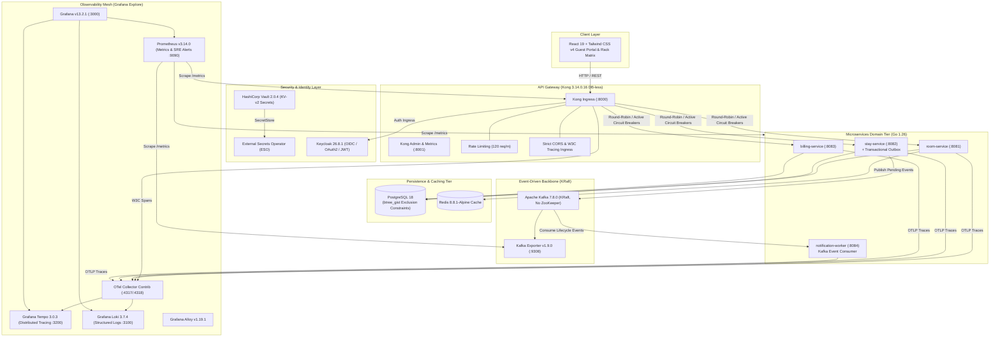

# Hotel Premium - Enterprise Microservices Architecture & Operations Runbook

## 1. Executive Architecture Overview

`hotel_premium` is a decoupled, cloud-native enterprise luxury hospitality management platform built using Domain-Driven Design (DDD), Clean Architecture, Event-Driven Architecture (EDA) with Apache Kafka 7.8.0 in KRaft mode, HashiCorp Vault 2.0.4 with External Secrets Operator (ESO), Kong API Gateway 3.14 DB-less, and a complete Observability Mesh (Tempo, Loki, Prometheus, Alloy, OpenTelemetry Collector, and Grafana Explore).



---

## 2. Service Catalog & Ports Matrix

| Service Component | Port (Internal) | Host Port | Technology Stack | Responsibilities |
|---|---|---|---|---|
| **Kong API Gateway** | `8000`, `8001` | `8000`, `8001` | Kong Gateway 3.14.0.16 | Reverse proxy, routing, circuit breaking, OTel tracing, rate limiting |
| **Frontend Web** | `80` | `80` | React 19, Tailwind CSS v4, Nginx | Luxury Guest Booking Portal, Room Rack Matrix, Reservation Manager |
| **Room Service** | `8081` | `8081` | Go 1.26, pgx/v5, Redis 8.8.1 | Room inventory, room categories, housekeeping statuses |
| **Stay Service** | `8082` | `8082` | Go 1.26, pgx/v5, Kafka Outbox | Reservations, check-in, check-out, GiST range exclusion anti-double booking |
| **Billing Service** | `8083` | `8083` | Go 1.26, pgx/v5 | Folio billing, room charges, point-of-sale invoicing |
| **Notification Worker**| `8084` | `8084` | Go 1.26, segmentio/kafka-go | Asynchronous Kafka event consumer, VIP guest notifications, housekeeping alerts |
| **Apache Kafka** | `29092`, `9092` | `9092` | Confluent Kafka 7.8.0 (KRaft) | Event-driven messaging backbone with 3 partitions per topic |
| **Kafka Exporter** | `9308` | `9308` | Kafka Exporter v1.9.0 | Topic partition lag, consumer group offsets, broker metrics |
| **HashiCorp Vault** | `8200` | `8200` | HashiCorp Vault 2.0.4 | KV-v2 engine, AppRole auth, secret engine for microservices & ESO |
| **Keycloak IAM** | `8080` | `8181` | Keycloak 26.8.1 | OIDC realm, JWT tokens, RBAC roles (`admin_user`, `basic_user`) |
| **PostgreSQL** | `5432` | `5432` | PostgreSQL 18-Alpine | Relational persistence, GiST exclusion constraints, outbox events |
| **Redis** | `6379` | `6379` | Redis 8.8.1-Alpine | L1 caching for room racks and session tokens |
| **Grafana** | `3000` | `3000` | Grafana 13.2.1 | Unified Explore UI, Tempo Service Graph, Loki correlation |
| **Tempo** | `3200`, `4317` | `3200` | Grafana Tempo 3.0.3 | Distributed tracing backend, service maps, span metrics generator |
| **Loki** | `3100` | `3100` | Grafana Loki 3.7.4 | High-efficiency structured JSON log aggregation |
| **Prometheus** | `9090` | `9090` | Prometheus 3.14.0 | TSDB metrics collection, active SRE alerting rules |
| **OTel Collector** | `4317`, `4318` | `4317`, `4318` | OpenTelemetry Collector Contrib 0.159.0 | OTLP telemetry ingestion pipeline (traces, metrics, logs) |

---

## 3. Distributed Tracing & Grafana Explore Integration

### Unified Service Discovery in Tempo
All services propagate distributed context via W3C `traceparent` headers (`00-{trace_id}-{span_id}-{flags}`) and are automatically queryable in Grafana Explore (`http://localhost:3000/explore`) using the **Tempo** datasource:
1. `kong-api-gateway` (Kong Ingress Spans)
2. `room-service` (Go 1.26 Server Spans)
3. `stay-service` (Go 1.26 Server & Database Spans)
4. `billing-service` (Go 1.26 Server Spans)
5. `notification-worker` (Async Kafka Consumer Spans)

### Bidirectional Observability Correlation
- **Traces ➔ Logs (Tempo ➔ Loki)**: Click "Logs for this span" inside any Tempo trace in Grafana Explore to immediately view correlated JSON logs filtered by `trace_id`.
- **Logs ➔ Traces (Loki ➔ Tempo)**: Click the `TraceID` or `W3CTraceID` derived field in Loki logs to jump directly into the full Tempo timeline.
- **Traces ➔ Metrics (Tempo ➔ Prometheus)**: Tempo Metrics Generator generates span rate (`traces_spanmetrics_calls_total`) and P95 latency (`traces_spanmetrics_latency_bucket`) queryable in Prometheus.
- **NodeGraph & Service Map**: Visualizes dependencies dynamically:
  `kong-api-gateway` ➔ `room-service` & `stay-service` ➔ `Kafka 7.8.0` ➔ `notification-worker`.

---

## 4. Resilience & The Transactional Outbox Pattern

To prevent dual-write inconsistencies between database transactions and message broker calls, `stay-service` implements the **Transactional Outbox Pattern**:
1. When a reservation is created, updated, or cancelled, the event payload is inserted into `stay_outbox_events` in the **same atomic database transaction** as the reservation.
2. A dedicated background goroutine (`OutboxPublisher`) periodically scans `stay_outbox_events` using `SELECT ... FOR UPDATE SKIP LOCKED` and publishes pending events to Kafka.
3. If Kafka is temporarily down, reservations are still confirmed with zero downtime for guests. Once Kafka recovers, all pending events are drained in strict FIFO sequence.
4. **Resilience Verification**: Run `pwsh -File ./scripts/resilience-test.ps1` to automatically execute a live chaos experiment pausing Kafka and verifying zero-loss event recovery.

---

## 5. Security & Secret Management (HashiCorp Vault & ESO)

1. **Vault KV-v2 Storage**:
   - `secret/data/hotel-premium/database` (DB Host, credentials, pool limits)
   - `secret/data/hotel-premium/jwt` (JWT signing secret, expiration hours)
   - `secret/data/hotel-premium/keycloak` (OAuth2 client ID and secret)
2. **External Secrets Operator (ESO)**:
   - Manifests in `infrastructure/vault/eso/` define `ClusterSecretStore` and `ExternalSecret` resources to synchronize Vault secrets directly into Kubernetes Secrets in production.

---

## 6. SRE Alerting Rules (Prometheus)

Alert rules in `infrastructure/prometheus/alerts.yml`:
- **`HotelMicroserviceDown`**: Triggered if any microservice instance (`room-service`, `stay-service`, `billing-service`, `notification-worker`) is down for > 30s (`severity: critical`).
- **`KongGatewayDown`**: Triggered if Kong API Gateway stops responding on `:8001` for > 30s (`severity: page`).
- **`KafkaHighConsumerLag`**: Triggered if consumer group lag exceeds 50 messages (`severity: warning`).
- **`VaultInstanceDown`**: Triggered if Vault instance is unreachable or sealed (`severity: critical`).
- **`KongUpstreamTargetUnhealthy`**: Triggered if active healthchecks trip a circuit breaker on an upstream target (`severity: warning`).
- **`PostgresConnectionSaturation`**: Triggered if active database connections exceed 80% pool capacity (`severity: warning`).

---

## 7. Operations & Useful Commands

```bash
# Check all container states
docker compose ps

# Run automated resilience & chaos test
pwsh -File ./scripts/resilience-test.ps1

# Query active services in Tempo
curl -s http://localhost:3200/api/search/tag/service.name/values

# Query Prometheus targets
curl -s http://localhost:9090/api/v1/targets

# Query Kong Gateway status and plugins
curl -s http://localhost:8001/status
curl -s http://localhost:8001/plugins

# Verify Kafka topics
docker exec hotel_kafka kafka-topics --bootstrap-server localhost:9092 --list
```
