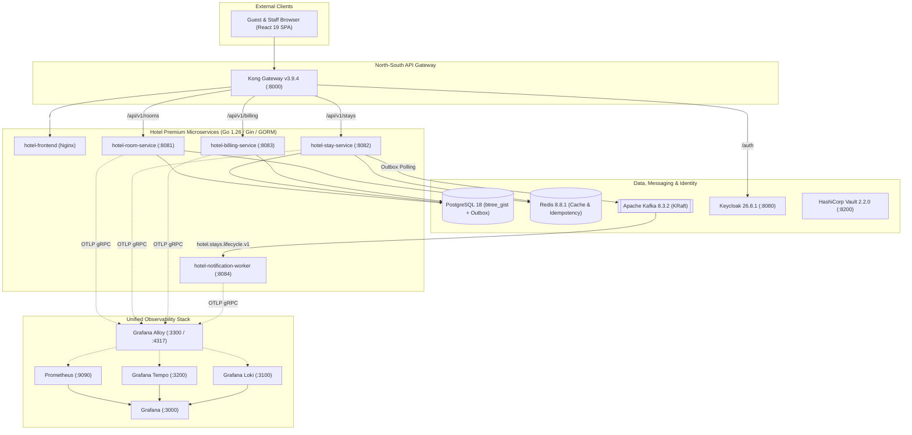

# Current State Architecture Assessment — `hotel_premium`

## 1. Executive Overview

`hotel_premium` is a cloud-native luxury hotel management and Guest Property Management System (PMS) built on a Go/Gin/GORM microservices backend and a React 19 + TypeScript + Tailwind CSS v4 frontend. It manages core hospitality bounded contexts:

- **Room Inventory & Rack Management (`room-service`, `:8081`)**: Luxury room catalog (`SGL`, `DBL`, `STE`), real-time housekeeping status transitions (`AVAILABLE`, `OCCUPIED`, `MAINTENANCE`, `CLEANING`), and dynamic pricing overrides.
- **Reservations, Stays & Check-In/Out (`stay-service`, `:8082`)**: Reservation lifecycle (`RESERVED`, `ACTIVE`, `COMPLETED`, `CANCELLED`, `NO_SHOW`), temporal overlap prevention via PostgreSQL `btree_gist` exclusion constraints (`stays_room_period_exclusion`), in-process Saga orchestration (`BookingSagaOrchestrator`), transactional outbox publishing (`stay_outbox_events`), and Server-Sent Events (`/api/v1/events/live`).
- **Folios, POS Charges & Cash Shifts (`billing-service`, `:8083`)**: Guest folios, minibar/POS product catalog (`products`), itemized stay charges (`stay_charges`), and receptionist cash shift reconciliation (`cash_shifts`).
- **Asynchronous Event Processing (`notification-worker`, `:8084`)**: Kafka consumer reading from `hotel.stays.lifecycle.v1` with exponential backoff and Dead Letter Queue (`hotel.stays.lifecycle.v1.dlq`) routing.
- **Guest Showcase & Staff Operations Portal (`frontend`, `:80` / `:5173`)**: Dual-persona React SPA featuring a luxury public booking showcase (`GuestShowcase`, `GuestBookingModal`, `GuestComparisonModal`) and a staff operations dashboard (`RoomMatrix`, `ReservationsManager`, `QuickCheckInModal`, `AdminPanelModal`).

---

## 2. Current Technology Inventory & Verified Versions

| Layer | Component | Verified Version in Repository | Current Configuration Location |
| :--- | :--- | :--- | :--- |
| **Language & Runtime** | Go | `1.26` | `backend/go.mod`, `backend/Dockerfile` |
| **HTTP Framework** | Gin | `v1.12.0` | `backend/go.mod`, `backend/internal/infrastructure/http/gin_router.go` |
| **ORM & Database Driver** | GORM + `pgx/v5` | `gorm.io/gorm v1.31.2`, `gorm.io/driver/postgres v1.6.3`, `jackc/pgx/v5 v5.10.0` | `backend/internal/infrastructure/postgres/` |
| **Frontend Framework** | React + TypeScript + Vite + Tailwind CSS | React `19.0.0`, TS `5.7.2`, Vite `6.1.0`, Tailwind `4.0.6` | `frontend/package.json` |
| **API Gateway (North-South)** | Kong Gateway (DB-less) | `3.9.4` | `infrastructure/kong/kong.yaml`, `k8s/minikube/infra/kong.yaml` |
| **Service Mesh (East-West)** | Istio + Kiali | Istio `1.31.2`, Kiali `v2.33.0` | `k8s/minikube/infra/istio-gateway.yaml`, `k8s/minikube/infra/kiali.yaml` |
| **Relational Database** | PostgreSQL | `18-alpine` | `compose.yaml`, `backend/migrations/000000..000003` |
| **Cache & Idempotency** | Redis + Redis Exporter | `8.8.1-alpine` (`go-redis/v9 v9.7.1`), `oliver006/redis_exporter:v1.94.0` | `infrastructure/redis/redis.conf`, `backend/internal/infrastructure/redis/` |
| **Event Streaming** | Apache Kafka (KRaft) | Confluent `8.3.2` (`segmentio/kafka-go v0.4.51`) | `compose.yaml`, `infrastructure/kafka/init-topics.sh` |
| **Identity & Access (IAM)** | Keycloak | `26.8.1` | `keycloak/hotel-realm-realm.json`, `k8s/minikube/infra/keycloak.yaml` |
| **Secrets Management** | HashiCorp Vault + ESO | Vault `2.2.0` / ESO `v1beta1` | `infrastructure/vault/`, `infrastructure/eso/` |
| **Observability** | Alloy, Tempo, Loki, Prometheus, Grafana | Alloy `v1.21.0` (`:3300`), Tempo `3.0.5` (`:3200`), Loki `3.7.8` (`:3100`), Prometheus `v3.14.0` (`:9090`), Grafana `13.2.3` (`:3000`) | `infrastructure/alloy/`, `infrastructure/tempo/`, `infrastructure/loki/`, `infrastructure/prometheus/`, `infrastructure/grafana/` |

---

## 3. Current Topology Diagram

---

## 4. Critical Architectural Findings Identified in Phase 0 Discovery

### 4.1 Security & Identity Gaps
1. **Unverified Header Trust & Substring Auth Bypass (`backend/internal/infrastructure/http/rbac.go:26-61`)**:
   - `GinRBACMiddleware` directly trusts client-supplied `X-User-Role` headers without cryptographic JWT signature verification and grants `RoleAdmin` whenever `Authorization` contains the substring `"admin"`.
   - Mutating routes (`PATCH /api/v1/rooms/:id/status`, all `/api/v1/stays/*`, `POST /api/v1/billing/charges`) lack RBAC enforcement.
   - Only `ADMIN` and `USER` roles are defined in `rbac.go`, whereas the PostgreSQL domain schema supports `ADMIN`, `MANAGER`, `RECEPTIONIST`, and `HOUSEKEEPING`.
2. **Kong Ingress Header Spoofing & Admin Surface**:
   - Kong (`infrastructure/kong/kong.yaml`) does not strip spoofed client `X-Authenticated-Role` headers unless verified, omits `X-User-Role` / `Idempotency-Key` from CORS allowed headers in Compose, and binds the Kong Admin API to `0.0.0.0:8001` instead of `127.0.0.1:8001`.
3. **Keycloak Wildcard Redirect URI**:
   - `keycloak/hotel-realm-realm.json` includes `"*"` in `redirectUris` and `webOrigins` for `hotel-frontend`.

### 4.2 Data, GORM & Messaging Defects
1. **PostgreSQL Generated Column Conflict (`gorm_billing_repository.go:255-269`)**:
   - `stay_charges.total_price` is `GENERATED ALWAYS AS (quantity * unit_price) STORED` in `000001_init_schema.sql:137`, but `StayChargeModel.TotalPrice` in `gorm_db.go:115` lacks `gorm:"->;<-:false"`, causing `tx.Create(&m)` to fail on PostgreSQL when inserting a non-DEFAULT value into `total_price`.
2. **Missing `audit_logs` Migration**:
   - `AuditRepository` (`internal/infrastructure/postgres/audit_log.go`) writes to `audit_logs`, which has no migration in `backend/migrations/`.
3. **Swallowed Transaction Errors**:
   - `gorm_stay_repository.go` and `gorm_billing_repository.go` ignore `tx.Exec(...)` errors (`_ = tx.Exec(...)`) during room status updates, folio total updates, stock deductions, and outbox event insertions.
4. **Dual Connection Pools in `stay-service`**:
   - `cmd/stay-service/main.go` initializes both `gorm.DB` and `pgxpool.Pool` instead of reusing the underlying `*sql.DB` or GORM connection for `OutboxPublisher`.
5. **Kafka Outbox Event Name Mismatch (`notification-worker`)**:
   - `GormStayRepository.Create` writes `event_type = 'STAY_CREATED'`, while `notification-worker/main.go:163` switches on `"StayCreated"`, `"GuestCheckedOut"`, and `"StayCancelled"`. Furthermore, `CheckOut` and `Cancel` in `GormStayRepository` do not write outbox events.

### 4.3 Networking, Docker Compose & Frontend Integration Defects
1. **Kong & Prometheus DNS Mismatch in Docker Compose**:
   - `infrastructure/kong/kong.yaml` targets `room-service:8081`, `stay-service:8082`, `billing-service:8083`, and `frontend:80`, while `compose.yaml` names the services `hotel-room-service`, `hotel-stay-service`, `hotel-billing-service`, and `hotel-frontend`.
   - `infrastructure/prometheus/prometheus.yml` targets `room-service:8081` and `kafka_exporter:9308` instead of `hotel-room-service:8081` and `kafka-exporter:9308`.
2. **Frontend Nginx Port & API Base URL Mismatch**:
   - `frontend/nginx.conf` listens only on `5173` and hardcodes Kubernetes DNS `10.96.0.10`, while `compose.yaml` and Kong target port `80`.
   - `.env`, `.env.example`, `compose.yaml`, and `frontend/Dockerfile` set `VITE_API_BASE_URL=/api` instead of `/api/v1`, causing frontend requests to hit `/api/rooms` (`404 Not Found`) and silently fall back to in-memory mock data.
3. **Missing SSE & Notification Routes in Kong**:
   - `/api/v1/events/live` and `/api/v1/notifications` are not routed in `infrastructure/kong/kong.yaml`.

### 4.4 Kubernetes, Helm, Terraform & CI/CD Gaps
1. **Image Naming Discrepancy**:
   - `compose.yaml` and `notes.md` mandate `georgegxx/hotel-*:1.0.0`, while `k8s/helm/hotel-premium/values.yaml`, `k8s/minikube/services/hotel-services.yaml`, and `platform-minikube.ps1` reference `georgegxx/room-service:1.0.0` (missing the `hotel-` prefix).
2. **Missing ConfigMap & Gatekeeper Parameter Bug**:
   - `k8s/minikube/services/hotel-services.yaml` mounts an undefined `hotel-postgres-init` ConfigMap.
   - `devsecops/policies/gatekeeper/constraints/security-constraints.yaml` passes `parameters.trusted_registries` instead of `parameters.registries`, causing Gatekeeper to block all pods.
3. **Missing Production AWS Terraform**:
   - Only `terraform/environments/local-minikube/` exists; AWS EKS, VPC, RDS, ElastiCache, MSK, ECR, KMS, and IAM/IRSA modules are absent.
4. **CI/CD Soft-Fails & Commented-Out CD**:
   - `.github/workflows/ci-devsecops.yml` uses `|| true` on TFLint and Conftest and sets `go-version: "1.23.x"` instead of `1.26`.
   - `.github/workflows/cd-aws.yml` has its build, Cosign, and EKS deployment steps commented out.
   - Legacy test artifacts (`devsecops/testing/newman/microservices.postman_collection.json`, `devsecops/testing/k6/load-test.js`, `scripts/bootstrap-keycloak.ps1`) reference foreign `microservices-architecture` endpoints.
