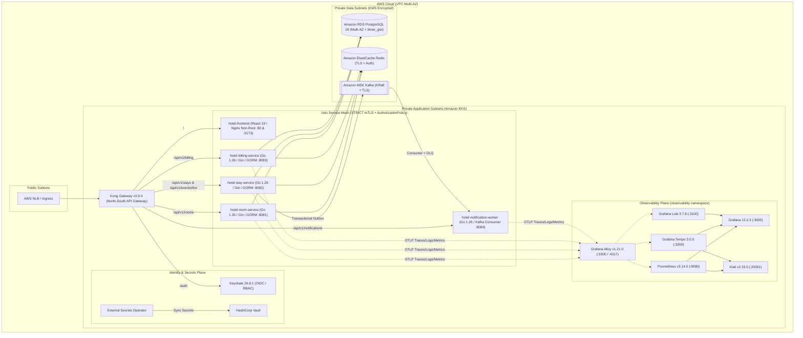

# Target State Architecture — `hotel_premium`

## 1. Architectural Vision

The target state of `hotel_premium` is a cloud-native, zero-trust, observable, and production-ready hospitality platform running on **Amazon EKS** (production) and **Minikube / Docker Compose** (local development), adhering strictly to Domain-Driven Design (DDD), Clean Architecture, and DevSecOps automation.

### Non-Negotiable Stack Constraints
- **Cloud & IaC**: AWS only (Amazon EKS, Amazon RDS PostgreSQL, Amazon ElastiCache Redis, Amazon MSK Kafka, Amazon ECR, AWS KMS, IAM Roles for Service Accounts / OIDC), provisioned via modular **Terraform** and packaged via **Helm**.
- **Backend**: **Go 1.26**, **Gin v1.12.0**, **GORM v1.31.2** (`gorm.io/driver/postgres v1.6.3`), native Go concurrency (`goroutines`, `channels`, `context`, `sync.WaitGroup`, `singleflight`).
- **Frontend**: **React 19** + **TypeScript 5.7** + **Tailwind CSS v4** with strict type safety, WCAG accessibility, real backend API integration, idempotency keys, and billing/folio management.
- **API Gateway & Service Mesh Separation**:
  - **Kong Gateway v3.9.4** (North-South): Edge entry point, routing, rate limiting, CORS, security headers, correlation IDs, header sanitization, and OIDC/JWT integration.
  - **Istio 1.31.2 + Kiali v2.33.0** (East-West): Workload identity (SPIFFE), `PeerAuthentication` with `STRICT` mTLS, `DestinationRule` with `ISTIO_MUTUAL` and outlier detection, and least-privilege `AuthorizationPolicy`.
- **Observability Pipeline**: **Grafana Alloy** (`:3300` / `:4317`) as the unified telemetry collector forwarding distributed traces to **Grafana Tempo** (`:3200`), structured JSON logs to **Grafana Loki** (`:3100`), and metrics to **Prometheus** (`:9090`), visualized in **Grafana** (`:3000`) and **Kiali** (`:20001`).
- **CI/CD**: **GitHub Actions** with zero soft-fails (`|| true` / `continue-on-error` removed), AWS OIDC authentication, Gitleaks, Semgrep, Trivy, TFLint, Conftest/OPA, CycloneDX SBOM generation, and Cosign image signing/verification by immutable `@sha256` digest.

---

## 2. Target Architecture Topology

---

## 3. Bounded Contexts & Domain Responsibilities

| Bounded Context | Service | Aggregate Root(s) | Key Invariants & Persistence Patterns |
| :--- | :--- | :--- | :--- |
| **Inventory & Housekeeping** | `hotel-room-service` | `Room`, `RoomCategory` | Valid status state machine (`AVAILABLE` ↔ `OCCUPIED` ↔ `CLEANING` ↔ `MAINTENANCE`); positive floor and base price; Redis read-through cache (`singleflight`) invalidated on state/price mutation. |
| **Reservations & Stays** | `hotel-stay-service` | `Stay`, `Guest` | Check-out strictly after check-in; zero temporal overlap enforced by PostgreSQL GiST exclusion constraint (`stays_room_period_exclusion`); atomic room state transition + `stay_outbox_events` + `audit_logs` insertion within a single GORM transaction. |
| **Folios & POS Billing** | `hotel-billing-service` | `StayCharge`, `Product`, `CashShift` | `total_price` computed by PostgreSQL `GENERATED ALWAYS AS (quantity * unit_price) STORED`; atomic stay `total_amount` increment and product `stock` decrement; single open `CashShift` per receptionist. |
| **Guest Communications & Telemetry** | `hotel-notification-worker` | `StayLifecycleEvent` | Idempotent event processing (Redis deduplication key `notif:dedup:<event_id>`); bounded worker pool; exponential backoff with jitter; unrecoverable payloads routed to `hotel.stays.lifecycle.v1.dlq`. |

---

## 4. Separation of Concerns: Kong vs. Istio

| Responsibility | Kong Gateway v3.9.4 (North-South) | Istio 1.31.2 + Kiali (East-West) |
| :--- | :--- | :--- |
| **Traffic Direction** | External client (`Browser`, `API Consumer`) into the cluster | Pod-to-pod communication inside the cluster |
| **Authentication & Identity** | OIDC/JWT validation, stripping spoofed client `X-Internal-*` headers, injecting verified claims | SPIFFE workload identity (`cluster.local/ns/dev/sa/<service>-sa`) and `STRICT` mTLS |
| **Traffic Protection** | Edge rate limiting, request size limiting, CORS, security response headers | Circuit breaking (`DestinationRule` outlier detection), connection pool limits, retry budgets, timeouts (`VirtualService`) |
| **Authorization** | Route-level API access control | L4/L7 `AuthorizationPolicy` (default-deny + explicit allow from `kong-gateway` and authorized peer services) |
| **Observability** | Edge HTTP access logs, status codes, latency metrics, W3C `traceparent` propagation | Envoy sidecar mTLS telemetry, service topology graph, and trace correlation in Kiali |
