# Deployment Strategy & Promotion Pipeline — `hotel_premium`

## 1. Environment Promotion Model

`hotel_premium` follows a strict build-once, promote-by-digest pipeline across three environments:

| Environment | Target Runtime | Helm Values File | Replicas & Scaling | Database & Messaging |
| :--- | :--- | :--- | :--- | :--- |
| **Local / Dev** | Docker Compose / Minikube (`dev` namespace) | `values-dev.yaml` | 1 replica per service, HPA min 1 / max 3 | Local PostgreSQL 18, Redis 8.8.1, Kafka 8.3.2 containers |
| **Staging** | Amazon EKS (`hotel-staging` namespace) | `values-staging.yaml` | 2 replicas per service, HPA min 2 / max 5, PDB `minAvailable: 1` | Amazon RDS PostgreSQL (Single-AZ), ElastiCache Redis, Amazon MSK |
| **Production** | Amazon EKS (`hotel-prod` namespace) | `values-prod.yaml` | 3 replicas per service, HPA min 3 / max 10, PDB `minAvailable: 2`, topology spread across 3 AZs | Amazon RDS PostgreSQL (Multi-AZ + KMS), ElastiCache Redis (Multi-AZ), Amazon MSK (3-AZ) |

---

## 2. CI/CD Pipeline Architecture (GitHub Actions)

```mermaid
flowchart LR
    Commit["Git Push / PR"] --> SecretScan["Gitleaks + Semgrep SAST"]
    SecretScan --> IaCGate["Terraform fmt/validate + TFLint + Conftest OPA"]
    IaCGate --> AppTest["Go 1.26 Race Tests + React/TS Vitest & Build"]
    AppTest --> BuildImg["Build 5 Service Images (georgegxx/hotel-*:1.0.0)"]
    BuildImg --> TrivySBOM["Trivy Image Scan (CRITICAL/HIGH Block) + CycloneDX SBOM"]
    TrivySBOM --> CosignSign["Push to ECR & Cosign Keyless OIDC Sign (@sha256)"]
    CosignSign --> DeployEKS["Verify Cosign Signature -> Helm Upgrade --atomic on EKS"]
```



### Mandatory Quality & Security Gates
1. **Zero Soft-Fails**: No security or quality step uses `|| true` or `continue-on-error: true`.
2. **AWS OIDC Authentication**: GitHub Actions authenticates to AWS via short-lived OIDC tokens (`aws-actions/configure-aws-credentials@v4`) using IAM role `github-actions-eks-deployer` — zero static AWS keys stored in GitHub Secrets.
3. **Immutable Image Verification**: Every microservice image (`hotel-room-service`, `hotel-stay-service`, `hotel-billing-service`, `hotel-notification-worker`, `hotel-frontend`) is scanned by Trivy, cataloged with a CycloneDX SBOM, signed by Cosign, and verified with `cosign verify` prior to `helm upgrade --install --atomic`.

---

## 3. Zero-Downtime Rollout & Automated Rollback

### 3.1 Rolling Update Strategy
All stateless deployments in `k8s/helm/hotel-premium` use:
```yaml
strategy:
  type: RollingUpdate
  rollingUpdate:
    maxSurge: 1
    maxUnavailable: 0
```
Combined with:
- **Readiness Probes** (`/api/v1/health` for Go services, `/` for Nginx frontend) so Kubernetes and Istio Envoy sidecars only route traffic after database/cache connections are warm.
- **Graceful Shutdown**: Every Go microservice traps `SIGINT`/`SIGTERM` (`signal.Notify`) and drains in-flight HTTP requests and Kafka consumers within a 10-second `context.WithTimeout` window.
- **PodDisruptionBudgets (PDB)**: Guarantees at least `minAvailable: 1` (staging) or `minAvailable: 2` (production) pods remain available during voluntary node drains or EKS cluster upgrades.

### 3.2 Helm 4.3.1 Server-Side Apply & Rollback Procedure
- **Helm 4 Server-Side Apply (`--server-side --wait=watcher`)**: Local Minikube (`.\platform-minikube.ps1 helm`) and EKS deployments leverage Helm `v4.3.1` with Kubernetes Server-Side Apply (`--server-side --force-conflicts`) and the event-driven `--wait=watcher` engine for deterministic field ownership and fast readiness tracking.
- **Istio Progressive Canary Delivery (`.\platform-minikube.ps1 canary`)**: Traffic between stable (`v1`) and canary (`v2`) subsets is dynamically shifted via Istio `VirtualService` and `DestinationRule` weights:
  ```powershell
  .\platform-minikube.ps1 canary -Action weight -ServiceName room-service -V1Weight 90 -V2Weight 10
  .\platform-minikube.ps1 canary -Action promote -ServiceName room-service
  ```
- **Automated & Manual Emergency Rollback**:
  ```powershell
  .\platform-minikube.ps1 rollback -ServiceName room-service -Revision 1
  # Or directly via Helm 4.3.1:
  helm history hotel-premium -n hotel-prod
  helm rollback hotel-premium <PREVIOUS_REVISION> -n hotel-prod --wait=watcher
  ```

---

## 4. Database Migration Strategy

- All SQL migrations in `backend/migrations/` (`000000_create_keycloak_db.sql` through `000004_create_audit_logs.sql`) are written to be **idempotent and backward-compatible** (`CREATE TABLE IF NOT EXISTS`, `CREATE INDEX IF NOT EXISTS`, `ON CONFLICT DO NOTHING`).
- Destructive schema changes (dropping columns or renaming tables) follow the **Expand-and-Contract** pattern across two releases so active pods during a rolling update never encounter missing columns.
